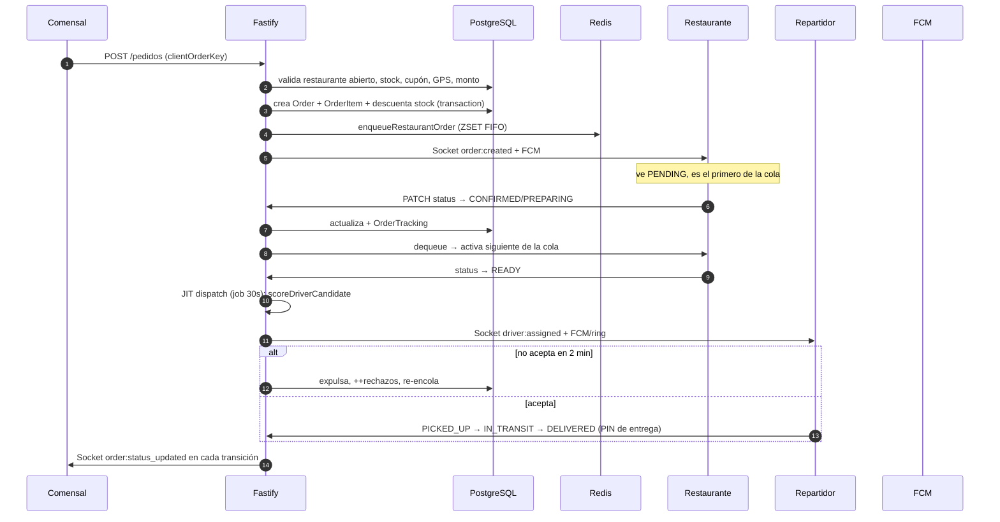

# SaDeL — Dossier técnico para entrevista

> Documento de defensa técnica. Datos verificados contra el código a fecha de la entrega.
> Cifras exactas, rutas de archivo y líneas. Si algo no está aquí, no está en el código.

---

## 1. Resumen ejecutivo (memorizar esto primero)

**SaDeL** es una plataforma de delivery multi-rol (restaurantes, repartidores y comensales) construida como monorepo. El cliente pide desde un panel web; el restaurante recibe el pedido en tiempo real y lo confirma; el sistema asigna un repartidor automáticamente; el repartidor reporta ubicación y estados; el comensal sigue su pedido en vivo y chat con los participantes.

- **Stack de servidor:** Fastify 5 + TypeScript + Prisma 5 + PostgreSQL 16 + Redis 7 + Socket.IO 4.
- **Clientes:** 4 apps Next.js 16 (admin, restaurante, repartidor, comensal) + 3 apps Android nativas con Capacitor 8.
- **Escala del backend:** 17 archivos de rutas, **205 endpoints**, 25 servicios, 23 jobs programados, 41 modelos de base de datos, 18 enums, 84 índices.
- **Tiempo real:** Socket.IO con salas por identidad (`${role}:${userId}`), autenticado en el handshake, con adapter de Redis para escalar horizontalmente.
- **Notificaciones:** FCM (móvil), Web Push/VAPID (web), WhatsApp Cloud API, SMS 360NRS y email SMTP — todo con reintentos y cola de reintentos en base de datos.
- **Despliegue:** Railway (Nixpacks), migraciones automáticas con reintentos en el arranque, healthcheck `/health`.

---

## 2. Arquitectura

### 2.1 Vista general

```mermaid
flowchart TB
  subgraph clients[Clientes]
    WA[Next.js Admin]
    WR[Next.js Restaurante]
    WD[Next.js Repartidor]
    WC[Next.js Comensal]
    AR[Android Capacitor 8\nRestaurante / Repartidor / Comensal]
  end

  subgraph edge[Edge / Railway]
    NGINX[Static web + Railway]
  end

  subgraph api[API - Fastify 5 Node]
    F[Fastify app.ts\nHelmet · CORS · RateLimit · Zod]
    AUTH[Middleware auth\nJWT + authorize(roles)]
    R[17 route files / 205 endpoints]
    S[25 servicios de dominio]
    J[23 jobs node-cron]
    IO[Socket.IO 4\nrooms role:userId]
  end

  subgraph data[Datos]
    PG[(PostgreSQL 16\nPrisma 5.7)]
    RD[(Redis 7\ncache · WhatsApp challenges · ring · queues · pub/sub)]
  end

  subgraph ext[Servicios externos]
    FCM[Firebase Cloud Messaging]
    WP[Web Push / VAPID]
    R2[Cloudflare R2\nimágenes S3-compatible]
    CF[Cloudflare Workers AI\nFLUX schnell]
    WA2[WhatsApp Cloud API]
    SMS[360NRS SMS]
    MAIL[SMTP / nodemailer]
    MAP[Mapbox / Google Maps]
  end

  clients --> NGINX --> F
  AR --> F
  clients <--> IO
  F --> AUTH --> R --> S
  J --> S
  S --> PG
  S --> RD
  IO --> RD
  S --> FCM & WP & R2 & CF & WA2 & SMS & MAIL
  S --> MAP
```

### 2.2 Flujo de un pedido, de punta a punta



### 2.3 Monorepo

| Paquete | Rol |
|---|---|
| `packages/backend` | API Fastify + jobs + Socket.IO |
| `packages/shared` | Tipos, esquemas Zod, utilidades, audio, temas de menú |
| `packages/web-restaurant` | Panel del restaurante |
| `packages/web-driver` | Panel del repartidor |
| `packages/web-customer` | App del comensal |
| `apps/restaurant-android` | App nativa restaurante (Capacitor 8) |
| `apps/driver-android` | App nativa repartidor (Capacitor 8) |
| `apps/customer-android` | App nativa comensal (Capacitor 8) |
| `infrastructure/database` | `init.sql` (extensiones) |
| `infrastructure/docker` | `docker-compose.yml` (Postgres 16, Redis 7) |
| `infrastructure/scripts` | `start-backend.sh` (migraciones + arranque con reintentos) |

- npm workspaces **solo** para `packages/*`; las apps `apps/*` son proyectos independientes con su propio `node_modules`.
- Orquestación con `concurrently` (scripts `dev`, `build`). Sin Turbo/Nx/Lerna.
- Requisitos: Node `>=18`, npm `>=9` (`package.json:41-42`).

---

## 3. Stack exacto por capa

### 3.1 Backend

| Tecnología | Versión | Para qué |
|---|---|---|
| Fastify | ^5.12.3 | Servidor HTTP y router |
| @fastify/jwt | ^10.2.2 | Emisión/verificación de JWT |
| @fastify/rate-limit | ^11.2.0 | Rate limit global (Redis) y por ruta |
| @fastify/helmet | ^13.1.1 | Headers de seguridad + CSP |
| @fastify/cors | ^11.3.0 | CORS dinámico por `CORS_ORIGIN` |
| Prisma / @prisma/client | ^5.7.1 | ORM + migraciones |
| ioredis | ^5.3.2 | Caché, retos de WhatsApp, colas, pub/sub, locks lógicos |
| socket.io | ^4.8.3 | Tiempo real |
| zod | ^3.22.4 | Validación de entrada |
| bcryptjs | ^2.4.3 | Hash de contraseñas (coste 10) |
| web-push | ^3.6.7 | Push a navegador (VAPID) |
| firebase-admin | ^14.2.0 | Push a Android (FCM) |
| sharp | ^0.35.3 | Procesamiento de imágenes (WebP, EXIF) |
| @aws-sdk/client-s3 | ^3.1094.0 | Cloudflare R2 |
| node-cron | ^4.2.1 | 23 jobs in-process |
| axios | ^1.6.5 | HTTP a APIs externas |
| nodemailer | ^9.0.4 | Email de cuenta y servicio |
| jest + ts-jest | dev | Tests unitarios e integración con `fastify.inject()` |

### 3.2 Frontend

Los 4 paneles web comparten exactamente las mismas dependencias:

| Tecnología | Versión |
|---|---|
| Next.js | ^16.3.4 (App Router) |
| React | ^18.2.0 |
| Tailwind CSS | ^3.4.1 |
| socket.io-client | ^4.7.2 |

Los web **no** se empaquetan dentro del APK: cargan la URL desplegada (`https://tutienda.pideloporsadel.app`, `https://reparto.pideloporsadel.app`). Consecuencia de arquitectura: actualizar la web es instantáneo; actualizar la lógica nativa exige nueva versión del APK.

### 3.3 Móvil (Capacitor 8)

`@capacitor/core`, `@capacitor/app`, `@capacitor/geolocation`, `@capacitor/haptics`, `@capacitor/push-notifications`, `@capacitor-community/keep-awake` ^8.0.1, `@capgo/capacitor-printer` ^8.1.1. Java 36 target, Kotlin 2.2, AGP 8.13.0, Gradle 8.14.

### 3.4 Infraestructura

| Pieza | Detalle |
|---|---|
| PostgreSQL | 16-alpine en Docker local (`infrastructure/docker/docker-compose.yml:3`); en producción, servicio gestionado de Railway |
| Redis | 7-alpine (`docker-compose.yml:23`); en producción, servicio gestionado |
| Despliegue | Railway, builder Nixpacks (`railway.json`) |
| Build remoto | `npm install --include=dev` → build de `@sadel/shared` → `prisma generate` → build de `@sadel/backend` |
| Arranque | `infrastructure/scripts/start-backend.sh`: `prisma migrate deploy` con **6 intentos** y 10 s de espera; luego backend con **5 intentos** y 15 s |
| Healthcheck | `GET /health`, timeout 300 s, `ON_FAILURE` con 10 reintentos |

---

## 4. APIs — 205 endpoints

Prefijos por scope extraídos del código: los endpoints cuelgan de la raíz del dominio (ej. `POST /pedidos`, `GET /restaurantes`), y el **scope** es lo que aplica `authenticate` + `authorize`. Los archivos de ruta usan sub-instancias de Fastify (`fastify.register(async function customerScope(customer) {...})`) para colgar el hook de auth a un grupo entero de rutas.

- **205 endpoints en 17 archivos de rutas**, agrupados abajo por dominio.
- La columna **Auth** indica los roles permitidos (`UserRole`): `ADMIN`, `RESTAURANT`, `CUSTOMER`, `DRIVER`.

| # | Método | Ruta | Archivo | Auth |
|---|---|---|---|---|

**auth** (15 rutas, incluidas las retiradas)

| Método | Ruta | Archivo | Auth (roles) |
|---|---|---|---|
| POST | `/auth/whatsapp/iniciar` | auth.routes.ts | público |
| POST | `/auth/whatsapp/estado` | auth.routes.ts | público |
| POST | `/auth/whatsapp/confirmar` | auth.routes.ts | público |
| POST | `/auth/enviar-codigo` | auth.routes.ts | retirado (410) |
| POST | `/auth/verificar-codigo` | auth.routes.ts | retirado (410) |
| GET | `/auth/perfil` | auth.routes.ts | público |
| POST | `/auth/check-phone` | auth.routes.ts | retirado (410) |
| POST | `/auth/check-email` | auth.routes.ts | retirado (410) |
| POST | `/auth/login` | auth.routes.ts | público |
| POST | `/auth/restaurant-login` | auth.routes.ts | público |
| POST | `/auth/admin-login` | auth.routes.ts | público |
| POST | `/auth/driver-login` | auth.routes.ts | público |
| POST | `/auth/reset-password` | auth.routes.ts | público |
| POST | `/auth/complete-register` | auth.routes.ts | público |
| POST | `/auth/refresh` | auth.routes.ts | público |

**public** — 11 endpoints

| Método | Ruta | Archivo:línea | Auth (roles) |
|---|---|---|---|
| GET | `/restaurantes` | public.routes.ts:121 | publico |
| GET | `/restaurantes/:id` | public.routes.ts:383 | publico |
| GET | `/store-categories` | public.routes.ts:507 | publico |
| GET | `/settings` | public.routes.ts:526 | publico |
| GET | `/public/promotions` | public.routes.ts:599 | publico |
| GET | `/public/billboards` | public.routes.ts:728 | publico |
| GET | `/public/featured` | public.routes.ts:789 | publico |
| GET | `/public/ofertas` | public.routes.ts:885 | publico |
| POST | `/public/solicitudes` | public.routes.ts:1090 | publico |
| GET | `/app/version` | public.routes.ts:1120 | publico |
| GET | `/public/zonas-activas` | public.routes.ts:1155 | publico |

**public-delivery** — 7 endpoints

| Método | Ruta | Archivo:línea | Auth (roles) |
|---|---|---|---|
| GET | `/public/delivery-ticket/:token` | public-delivery.routes.ts:29 | publico |
| POST | `/public/delivery-ticket/:token/lugar-seguro` | public-delivery.routes.ts:162 | publico |
| POST | `/public/delivery-ticket/:token/cliente-no-salio` | public-delivery.routes.ts:367 | publico |
| POST | `/public/delivery-ticket/:token/entregar` | public-delivery.routes.ts:681 | publico |
| POST | `/public/delivery-ticket/:token/ubicacion` | public-delivery.routes.ts:886 | publico |
| POST | `/public/delivery-ticket/:token/llegue` | public-delivery.routes.ts:981 | publico |
| POST | `/public/delivery-ticket/:token/llegue-restaurante` | public-delivery.routes.ts:1116 | publico |

**notification** — 4 endpoints

| Método | Ruta | Archivo:línea | Auth (roles) |
|---|---|---|---|
| POST | `/notifications/subscribe` | notification.routes.ts:22 | publico / token propio |
| POST | `/notifications/fcm-token` | notification.routes.ts:81 | publico / token propio |
| GET | `/notifications/vapid-key` | notification.routes.ts:140 | publico / token propio |
| POST | `/notifications/test-push` | notification.routes.ts:160 | publico / token propio |

**order-chat** — 2 endpoints

| Método | Ruta | Archivo:línea | Auth (roles) |
|---|---|---|---|
| GET | `/orders/:orderId/messages` | order-chat.routes.ts:17 | autenticado (cualquier rol) |
| POST | `/orders/:orderId/messages` | order-chat.routes.ts:116 | autenticado (cualquier rol) |

**order** — 8 endpoints

| Método | Ruta | Archivo:línea | Auth (roles) |
|---|---|---|---|
| POST | `/pedidos/validar-cupon` | order.routes.ts:86 | CUSTOMER |
| POST | `/pedidos` | order.routes.ts:179 | CUSTOMER |
| GET | `/me/pedidos` | order.routes.ts:317 | CUSTOMER |
| GET | `/me/pedidos/:id` | order.routes.ts:371 | CUSTOMER |
| POST | `/pedidos/:id/solicitar-cancelacion` | order.routes.ts:466 | CUSTOMER |
| POST | `/pedidos/:id/cancelar-solicitud` | order.routes.ts:504 | CUSTOMER |
| POST | `/pedidos/:id/confirmar-programacion` | order.routes.ts:546 | CUSTOMER |
| POST | `/pedidos/:id/rechazar-programacion` | order.routes.ts:669 | CUSTOMER |

**customer** — 15 endpoints

| Método | Ruta | Archivo:línea | Auth (roles) |
|---|---|---|---|
| GET | `/customer/profile` | customer.routes.ts:99 | CUSTOMER |
| PATCH | `/customer/profile/preferences` | customer.routes.ts:134 | CUSTOMER |
| GET | `/customer/addresses` | customer.routes.ts:175 | CUSTOMER |
| POST | `/customer/addresses` | customer.routes.ts:202 | CUSTOMER |
| POST | `/customer/addresses/verify` | customer.routes.ts:258 | CUSTOMER |
| PATCH | `/customer/addresses/:id` | customer.routes.ts:331 | CUSTOMER |
| DELETE | `/customer/addresses/:id` | customer.routes.ts:401 | CUSTOMER |
| PATCH | `/customer/profile/password` | customer.routes.ts:454 | CUSTOMER |
| PATCH | `/customer/profile` | customer.routes.ts:641 | CUSTOMER |
| POST | `/customer/support/tickets` | customer.routes.ts:756 | CUSTOMER |
| GET | `/customer/support/tickets` | customer.routes.ts:797 | CUSTOMER |
| POST | `/customer/pedidos/:id/review` | customer.routes.ts:832 | CUSTOMER |
| GET | `/customer/deuda` | customer.routes.ts:1009 | CUSTOMER |
| GET | `/customer/deuda/detalles` | customer.routes.ts:1059 | CUSTOMER |
| POST | `/customer/deuda/pagar` | customer.routes.ts:1118 | CUSTOMER |

**restaurant-panel** — 34 endpoints

| Método | Ruta | Archivo:línea | Auth (roles) |
|---|---|---|---|
| GET | `/restaurant-panel/perfil` | restaurant-panel.routes.ts:388 | RESTAURANT |
| GET | `/restaurant-panel/facturacion` | restaurant-panel.routes.ts:437 | RESTAURANT |
| GET | `/restaurant-panel/facturacion/periodo-actual/pedidos` | restaurant-panel.routes.ts:488 | RESTAURANT |
| GET | `/restaurant-panel/facturacion/:id/pedidos` | restaurant-panel.routes.ts:550 | RESTAURANT |
| POST | `/restaurant-panel/facturacion/:id/comprobante` | restaurant-panel.routes.ts:633 | RESTAURANT |
| PATCH | `/restaurant-panel/perfil` | restaurant-panel.routes.ts:704 | RESTAURANT |
| POST | `/restaurant-panel/extender-cierre` | restaurant-panel.routes.ts:816 | RESTAURANT |
| GET | `/restaurant-panel/horarios` | restaurant-panel.routes.ts:840 | RESTAURANT |
| PUT | `/restaurant-panel/horarios` | restaurant-panel.routes.ts:865 | RESTAURANT |
| GET | `/restaurant-panel/categorias` | restaurant-panel.routes.ts:912 | RESTAURANT |
| POST | `/restaurant-panel/categorias` | restaurant-panel.routes.ts:937 | RESTAURANT |
| PATCH | `/restaurant-panel/categorias/:id` | restaurant-panel.routes.ts:972 | RESTAURANT |
| DELETE | `/restaurant-panel/categorias/:id` | restaurant-panel.routes.ts:1035 | RESTAURANT |
| GET | `/restaurant-panel/productos` | restaurant-panel.routes.ts:1100 | RESTAURANT |
| POST | `/restaurant-panel/productos/generar-imagen` | restaurant-panel.routes.ts:1134 | RESTAURANT |
| POST | `/restaurant-panel/productos/generar-imagenes-faltantes` | restaurant-panel.routes.ts:1185 | RESTAURANT |
| POST | `/restaurant-panel/productos` | restaurant-panel.routes.ts:1291 | RESTAURANT |
| POST | `/restaurant-panel/productos/batch` | restaurant-panel.routes.ts:1387 | RESTAURANT |
| PATCH | `/restaurant-panel/productos/bulk/disponibilidad` | restaurant-panel.routes.ts:1511 | RESTAURANT |
| PATCH | `/restaurant-panel/productos/bulk/categoria` | restaurant-panel.routes.ts:1549 | RESTAURANT |
| DELETE | `/restaurant-panel/productos/bulk` | restaurant-panel.routes.ts:1604 | RESTAURANT |
| GET | `/restaurant-panel/productos/:id` | restaurant-panel.routes.ts:1658 | RESTAURANT |
| PATCH | `/restaurant-panel/productos/:id` | restaurant-panel.routes.ts:1718 | RESTAURANT |
| PATCH | `/restaurant-panel/productos/:id/disponibilidad` | restaurant-panel.routes.ts:1859 | RESTAURANT |
| DELETE | `/restaurant-panel/productos/:id` | restaurant-panel.routes.ts:1920 | RESTAURANT |
| PATCH | `/restaurant-panel/estado-operativo` | restaurant-panel.routes.ts:1978 | RESTAURANT |
| PATCH | `/restaurant-panel/password` | restaurant-panel.routes.ts:2028 | RESTAURANT |
| GET | `/restaurant/featured/packages` | restaurant-panel.routes.ts:2096 | RESTAURANT |
| POST | `/restaurant/featured/request` | restaurant-panel.routes.ts:2111 | RESTAURANT |
| GET | `/restaurant/featured/my-requests` | restaurant-panel.routes.ts:2173 | RESTAURANT |
| GET | `/restaurant-panel/promocodes` | restaurant-panel.routes.ts:2192 | RESTAURANT |
| POST | `/restaurant-panel/promocodes` | restaurant-panel.routes.ts:2210 | RESTAURANT |
| PATCH | `/restaurant-panel/promocodes/:id` | restaurant-panel.routes.ts:2259 | RESTAURANT |
| DELETE | `/restaurant-panel/promocodes/:id` | restaurant-panel.routes.ts:2311 | RESTAURANT |

**restaurant-orders** — 21 endpoints

| Método | Ruta | Archivo:línea | Auth (roles) |
|---|---|---|---|
| GET | `/restaurant-panel/pedidos` | restaurant-orders.routes.ts:61 | RESTAURANT |
| GET | `/restaurant-panel/pedidos/:id` | restaurant-orders.routes.ts:96 | RESTAURANT |
| GET | `/restaurant-panel/pedidos/:id/delivery-token` | restaurant-orders.routes.ts:128 | RESTAURANT |
| GET | `/restaurant-panel/repartidores/disponibles` | restaurant-orders.routes.ts:191 | RESTAURANT |
| POST | `/restaurant-panel/pedidos/:id/extender-tiempo` | restaurant-orders.routes.ts:630 | RESTAURANT |
| POST | `/restaurant-panel/pedidos/:id/reprogramar-entrega` | restaurant-orders.routes.ts:705 | RESTAURANT |
| POST | `/restaurant-panel/pedidos/:id/asignar-repartidor` | restaurant-orders.routes.ts:779 | RESTAURANT |
| PATCH | `/restaurant-panel/pedidos/:id/asumir-reparto` | restaurant-orders.routes.ts:959 | RESTAURANT |
| PATCH | `/restaurant-panel/pedidos/:id/quitar-repartidor` | restaurant-orders.routes.ts:1109 | RESTAURANT |
| PATCH | `/restaurant-panel/pedidos/:id/confirmar-pago-efectivo` | restaurant-orders.routes.ts:1249 | RESTAURANT |
| PATCH | `/restaurant-panel/pedidos/:id/handover` | restaurant-orders.routes.ts:1305 | RESTAURANT |
| PATCH | `/restaurant-panel/pedidos/:id/marcar-recogido` | restaurant-orders.routes.ts:1362 | RESTAURANT |
| PATCH | `/restaurant-panel/pedidos/:id/entregado` | restaurant-orders.routes.ts:1431 | RESTAURANT |
| GET | `/restaurant-panel/pedidos-apoyo` | restaurant-orders.routes.ts:1565 | RESTAURANT |
| PATCH | `/restaurant-panel/pedidos/:id/solicitar-apoyo` | restaurant-orders.routes.ts:1624 | RESTAURANT |
| POST | `/restaurant-panel/pedidos/:id/aceptar-apoyo` | restaurant-orders.routes.ts:1900 | RESTAURANT |
| POST | `/restaurant-panel/pedidos/:id/rechazar-apoyo` | restaurant-orders.routes.ts:2071 | RESTAURANT |
| POST | `/restaurant-panel/pedidos/:id/iniciar-entrega` | restaurant-orders.routes.ts:2155 | RESTAURANT |
| POST | `/restaurant-panel/pedidos/:id/responder-solicitud-cancelacion` | restaurant-orders.routes.ts:2286 | RESTAURANT |
| PATCH | `/restaurant-panel/pedidos/:id/cancelar` | restaurant-orders.routes.ts:2371 | RESTAURANT |
| POST | `/restaurant-panel/ubicacion` | restaurant-orders.routes.ts:2473 | RESTAURANT |

**driver-panel** — 21 endpoints

| Método | Ruta | Archivo:línea | Auth (roles) |
|---|---|---|---|
| GET | `/driver-panel/perfil` | driver-panel.routes.ts:56 | DRIVER |
| PATCH | `/driver-panel/perfil/photo` | driver-panel.routes.ts:134 | DRIVER |
| GET | `/driver-panel/billetera` | driver-panel.routes.ts:177 | DRIVER |
| GET | `/driver-panel/billetera/deuda` | driver-panel.routes.ts:355 | DRIVER |
| GET | `/driver-panel/billetera/settlements` | driver-panel.routes.ts:465 | DRIVER |
| POST | `/driver-panel/billetera/settlements` | driver-panel.routes.ts:490 | DRIVER |
| GET | `/driver-panel/billetera/periodo-actual/pedidos` | driver-panel.routes.ts:588 | DRIVER |
| GET | `/driver-panel/billetera/grafica` | driver-panel.routes.ts:644 | DRIVER |
| PATCH | `/driver-panel/disponibilidad` | driver-panel.routes.ts:772 | DRIVER |
| PATCH | `/driver-panel/password` | driver-panel.routes.ts:904 | DRIVER |
| GET | `/driver-panel/pedidos/pendientes` | driver-panel.routes.ts:963 | DRIVER |
| GET | `/driver-panel/pedidos/:id` | driver-panel.routes.ts:1028 | DRIVER |
| PATCH | `/driver-panel/pedidos/:id/llegue` | driver-panel.routes.ts:1371 | DRIVER |
| PATCH | `/driver-panel/pedidos/:id/dejar-lugar-seguro` | driver-panel.routes.ts:1473 | DRIVER |
| PATCH | `/driver-panel/pedidos/:id/cliente-no-salio` | driver-panel.routes.ts:1603 | DRIVER |
| PATCH | `/driver-panel/pedidos/:id/llegue-restaurante` | driver-panel.routes.ts:1849 | DRIVER |
| PATCH | `/driver-panel/pedidos/:id/liberar` | driver-panel.routes.ts:1951 | DRIVER |
| PATCH | `/driver-panel/pedidos/batch/:batchId/recogido` | driver-panel.routes.ts:2224 | DRIVER |
| GET | `/driver-panel/pedidos/batch/:batchId` | driver-panel.routes.ts:2278 | DRIVER |
| POST | `/driver-panel/ubicacion` | driver-panel.routes.ts:2308 | DRIVER |
| GET | `/driver-panel/historial` | driver-panel.routes.ts:2400 | DRIVER |

**admin** — 45 endpoints

| Método | Ruta | Archivo:línea | Auth (roles) |
|---|---|---|---|
| GET | `/admin/restaurantes` | admin.routes.ts:347 | ADMIN |
| GET | `/admin/restaurantes/overview` | admin.routes.ts:482 | ADMIN |
| GET | `/admin/usuarios/overview` | admin.routes.ts:489 | ADMIN |
| GET | `/admin/usuarios` | admin.routes.ts:572 | ADMIN |
| GET | `/admin/usuarios/:id` | admin.routes.ts:719 | ADMIN |
| POST | `/admin/usuarios/:id/status` | admin.routes.ts:896 | ADMIN |
| GET | `/admin/observabilidad/metricas` | admin.routes.ts:1029 | ADMIN |
| GET | `/admin/dashboard-stats` | admin.routes.ts:1036 | ADMIN |
| GET | `/admin/regiones` | admin.routes.ts:1392 | ADMIN |
| POST | `/admin/regiones` | admin.routes.ts:1405 | ADMIN |
| PATCH | `/admin/regiones/:code` | admin.routes.ts:1473 | ADMIN |
| DELETE | `/admin/regiones/:code` | admin.routes.ts:1527 | ADMIN |
| GET | `/admin/restaurantes/:id` | admin.routes.ts:1650 | ADMIN |
| POST | `/admin/restaurantes` | admin.routes.ts:1728 | ADMIN |
| PATCH | `/admin/restaurantes/:id` | admin.routes.ts:1809 | ADMIN |
| POST | `/admin/restaurantes/:id/status` | admin.routes.ts:1914 | ADMIN |
| DELETE | `/admin/restaurantes/:id` | admin.routes.ts:2010 | ADMIN |
| POST | `/admin/restaurantes/:id/billing/settle` | admin.routes.ts:2170 | ADMIN |
| POST | `/admin/billing/settlements/:id/confirm` | admin.routes.ts:2324 | ADMIN |
| POST | `/admin/billing/settlements/:id/reject` | admin.routes.ts:2411 | ADMIN |
| GET | `/admin/support/tickets` | admin.routes.ts:2462 | ADMIN |
| PATCH | `/admin/support/tickets/:id` | admin.routes.ts:2503 | ADMIN |
| DELETE | `/admin/support/tickets/:id` | admin.routes.ts:2534 | ADMIN |
| PUT | `/admin/settings` | admin.routes.ts:2551 | ADMIN |
| POST | `/admin/billing/force-settle/:restaurantId` | admin.routes.ts:2710 | ADMIN |
| GET | `/admin/billing/settlements` | admin.routes.ts:2759 | ADMIN |
| PATCH | `/admin/billing/settlements/:id` | admin.routes.ts:2813 | ADMIN |
| GET | `/admin/solicitudes` | admin.routes.ts:2959 | ADMIN |
| POST | `/admin/solicitudes/:id/approve` | admin.routes.ts:2976 | ADMIN |
| POST | `/admin/solicitudes/:id/reject` | admin.routes.ts:3137 | ADMIN |
| GET | `/admin/promotions` | admin.routes.ts:3186 | ADMIN |
| POST | `/admin/promotions` | admin.routes.ts:3197 | ADMIN |
| PATCH | `/admin/promotions/:id` | admin.routes.ts:3213 | ADMIN |
| DELETE | `/admin/promotions/:id` | admin.routes.ts:3231 | ADMIN |
| GET | `/admin/billboards` | admin.routes.ts:3253 | ADMIN |
| POST | `/admin/billboards` | admin.routes.ts:3264 | ADMIN |
| PATCH | `/admin/billboards/:id` | admin.routes.ts:3280 | ADMIN |
| DELETE | `/admin/billboards/:id` | admin.routes.ts:3298 | ADMIN |
| POST | `/admin/notifications/broadcast` | admin.routes.ts:3317 | ADMIN |
| GET | `/admin/featured/requests` | admin.routes.ts:3400 | ADMIN |
| PATCH | `/admin/featured/requests/:id` | admin.routes.ts:3432 | ADMIN |
| GET | `/admin/featured/settings` | admin.routes.ts:3511 | ADMIN |
| PUT | `/admin/featured/settings` | admin.routes.ts:3528 | ADMIN |
| GET | `/admin/customer-settlements` | admin.routes.ts:3562 | ADMIN |
| PATCH | `/admin/customer-settlements/:id` | admin.routes.ts:3597 | ADMIN |

**admin-categories** — 4 endpoints

| Método | Ruta | Archivo:línea | Auth (roles) |
|---|---|---|---|
| GET | `/admin/store-categories` | admin-categories.routes.ts:22 | ADMIN |
| POST | `/admin/store-categories` | admin-categories.routes.ts:41 | ADMIN |
| PUT | `/admin/store-categories/:id` | admin-categories.routes.ts:68 | ADMIN |
| DELETE | `/admin/store-categories/:id` | admin-categories.routes.ts:97 | ADMIN |

**admin-orders** — 6 endpoints

| Método | Ruta | Archivo:línea | Auth (roles) |
|---|---|---|---|
| GET | `/admin/orders` | admin-orders.routes.ts:38 | ADMIN |
| GET | `/admin/orders/:id` | admin-orders.routes.ts:103 | ADMIN |
| POST | `/admin/orders/:id/cancel` | admin-orders.routes.ts:202 | ADMIN |
| GET | `/admin/orders/stuck` | admin-orders.routes.ts:302 | ADMIN |
| POST | `/admin/orders/:id/resolve-stuck` | admin-orders.routes.ts:329 | ADMIN |
| POST | `/admin/orders/:id/reassign` | admin-orders.routes.ts:430 | ADMIN |

**admin-drivers** — 13 endpoints

| Método | Ruta | Archivo:línea | Auth (roles) |
|---|---|---|---|
| GET | `/admin/repartidores` | admin-drivers.routes.ts:99 | ADMIN |
| GET | `/admin/repartidores/overview` | admin-drivers.routes.ts:285 | ADMIN |
| GET | `/admin/repartidores/:id` | admin-drivers.routes.ts:372 | ADMIN |
| PUT | `/admin/repartidores/:id/billing` | admin-drivers.routes.ts:509 | ADMIN |
| GET | `/admin/repartidores/:id/orders` | admin-drivers.routes.ts:630 | ADMIN |
| GET | `/admin/repartidores/:id/finanzas` | admin-drivers.routes.ts:661 | ADMIN |
| GET | `/admin/repartidores/:id/settlements` | admin-drivers.routes.ts:759 | ADMIN |
| PUT | `/admin/repartidores/:driverId/settlements/:settlementId/status` | admin-drivers.routes.ts:775 | ADMIN |
| POST | `/admin/repartidores` | admin-drivers.routes.ts:890 | ADMIN |
| PATCH | `/admin/repartidores/:id` | admin-drivers.routes.ts:979 | ADMIN |
| POST | `/admin/repartidores/:id/ver-cuenta` | admin-drivers.routes.ts:1077 | ADMIN |
| POST | `/admin/repartidores/:id/status` | admin-drivers.routes.ts:1113 | ADMIN |
| DELETE | `/admin/repartidores/:id` | admin-drivers.routes.ts:1234 | ADMIN |

**uploads** — 1 endpoints

| Método | Ruta | Archivo:línea | Auth (roles) |
|---|---|---|---|
| POST | `/uploads/images` | uploads.routes.ts:31 | ADMIN/RESTAURANT/CUSTOMER/DRIVER |

**whatsapp-webhook** — 2 endpoints

| Método | Ruta | Archivo:línea | Auth (roles) |
|---|---|---|---|
| GET | `/webhooks/whatsapp` | whatsapp-webhook.routes.ts:58 | publico |
| POST | `/webhooks/whatsapp` | whatsapp-webhook.routes.ts:77 | publico |

**index** — 1 endpoints

| Método | Ruta | Archivo:línea | Auth (roles) |
|---|---|---|---|
| GET | `/` | index.routes.ts:26 | publico |

**TOTAL: 205 endpoints en 17 archivos de rutas**
**TOTAL: 205 endpoints en 17 archivos de rutas**


### 4.1 Autenticación y sesión

- **JWT de acceso:** `fastify.jwt` registrado en `app.ts:142-147`, secreto de `JWT_SECRET`. En producción **falla el arranque** si no está; en dev genera un hex aleatorio de 32 bytes (las sesiones no sobreviven reinicio). `expiresIn` por defecto 7 días.
- **Refresh tokens:** modelo `RefreshToken` (tokens opacos, no JWT) con rotación atómica en `services/refresh-token.service.ts:50` dentro de un `prisma.$transaction`: revoca el actual (`revokedAt`) y crea el nuevo en la misma transacción. Se almacena **hash SHA-256**, nunca el token en claro (`hashToken` en `utils/crypto.ts`). 30 días de vigencia. Si la rotación falla, la transacción no se confirma → el token viejo sigue vivo (evita perder la sesión por un fallo puntual).
- **Compatibilidad legacy:** la validación intenta también el token en claro para sesiones emitidas antes del hash.
- **Roles:** enum `UserRole` (ADMIN, RESTAURANT, CUSTOMER, DRIVER). `authorize([...])` en `middleware/auth.ts:134-164` devuelve 401 sin token y 403 con rol no autorizado. `authenticate()` además valida el estado de la cuenta (`ACTIVE` / `SUSPENDED` / `INACTIVE` → 403 `ACCOUNT_DISABLED`).
- **Verificación de comensales:** el registro y la recuperación usan un reto de WhatsApp iniciado por el usuario, con TTL de 300 s y máximo 5 inicios por hora y teléfono. Redis vincula el mensaje con un identificador aleatorio, el teléfono de 10 dígitos ingresado y la intención. El webhook exige firma HMAC de Meta y compara el remitente antes de confirmar.
- **Passwords:** bcryptjs coste 10. Hay un camino de migración: si el hash no tiene forma `$2[aby]$\d{2}$`, se compara en plano y **se re-hashea a bcrypt en el siguiente login exitoso**.
- **Rate limiting:** global 300 req / 60 s por IP con backing en Redis (`app.ts:149-160`), más límites por ruta para login e inicio, consulta y confirmación del reto de WhatsApp. Clave por IP resuelta con `trustProxy` de un solo salto.
- **Validación:** Zod en todos los endpoints mutantes; `safeParse` con errores 400 y código `INVALID_PAYLOAD`.
- **Errores:** `AppError` centralizado (`errors/app-error.ts`) + `errorHandler` global (`middleware/error.handler.ts`), con `requestId` en la respuesta para correlación.
- **CORS:** origen validado contra `CORS_ORIGIN` (soporta `*` o lista separada por comas), `credentials: true`. Helmet con CSP explícita.
- **Idempotencia de pedido:** `Order.clientOrderKey` es `@unique` en base de datos, no en Redis → la garantía es durable aunque el proceso se reinicie.
- **Cifrado en reposo:** AES-256-GCM (`utils/crypto.ts`), formato `iv:authTag:dato`, clave de `DATABASE_ENCRYPTION_KEY` con fallback a `JWT_SECRET` en dev, ysoporta rotación de clave probando `DATABASE_ENCRYPTION_KEYS` (lista separada por comas) antes de la actual.

---

## 5. Tiempo real y background jobs

### 5.1 Socket.IO

- **Montaje:** `SocketIOServer` instanciado sobre el `httpServer` compartido vía `serverFactory` (`app.ts:96-105`, `166-177`). `pingInterval` 10 s, `pingTimeout` 5 s.
- **Auth en handshake:** `io.use()` valida `socket.handshake.auth.token`; si falta o es inválido se rechaza con `Error('UNAUTHORIZED')` (`socket.service.ts:29-42`). El `userId` y `role` quedan en `socket.data`.
- **Salas:** una por identidad, nombre `${role}:${userId}` (`getRoom`). El cliente pide `join-room`, pero **el servidor ignora el valor que manda el cliente** y usa la identidad del token — un usuario no puede unirse a la sala de otro.
- **Helper único:** `emitNotification(io, userId, role, event, data, meta)` (`socket.service.ts:121-167`) envuelve el payload con `{ requestId?, orderId?, event, emittedAt }` y loguea éxito/fallo. 127 llamadas a este helper en el codebase: un solo punto de emisión.
- **Escalado horizontal:** si hay `REDIS_URL`, se duplica el cliente para pub/sub y se monta `io.adapter(createAdapter(client, subClient))` (`app.ts:208-236`). Si no hay Redis o falla el adapter, sigue funcionando en memoria.
- **Eventos por familia:** ciclo del pedido (`order:created`, `order:confirmed`, `order:ready`, `order:assigned`, `order:accepted`, `order:rejected`, `order:driver-auto-unassigned`, `order:cancellation-*`, `order:no_show`, `order:safe_place`, `order:rezagado`…), restaurante (`restaurant:queue_updated`, `restaurant:reopened`…), repartidor (`driver:assigned`, `driver:new_order_ringing`, `driver:pickup_alert`, `driver:location:<id>`), chat (`order_chat:new_message`).

### 5.2 Los 23 jobs

| Job | Cron | Función |
|---|---|---|
| `order-ring.job.ts` | `*/3 * * * * *` (3 s) | Reconcilia alarmas continuas de pedidos nuevos; si el pedido se acepta en otro dispositivo, la alarma se detiene igual |
| `order-timeout.job.ts` | `*/30 * * * * *` | Vence ventanas de decisión; auto-aprueba cancelaciones a los 5 min; auto-cierra restaurantes inactivos |
| `overdue-preparation.job.ts` | `*/${POLL_INTERVAL_SEC} * * * * *` (constante) | Escala alertas de preparación vencida |
| `stuck-order.job.ts` | `*/${POLL_INTERVAL_SEC} * * * * *` (constante) | Red de seguridad: detecta y recupera pedidos atascados |
| `own-delivery-timeout.job.ts` | `*/${POLL_INTERVAL_MIN} * * * *` (constante) | Vencimientos del flujo de delivery del propio restaurante |
| `restaurant-hours.job.ts` | `0 * * * * *` (cada minuto) | Apertura/cierre automático por horario |
| `featured-expiration.job.ts` | `* * * * *` | Expira destacados y promociones |
| `pickup-ready.job.ts` | `* * * * *` | Avisos de pedido listo para recoger |
| `scheduled-delivery-reminder.job.ts` | `* * * * *` | Recordatorios de entrega programada |
| `thank-you-messages.job.ts` | `* * * * *` | Mensajes de agradecimiento post-entrega |
| `payment-reminders.job.ts` | `*/10 * * * *` | Recordatorios de pago por transferencia |
| `notification-retry.job.ts` | `*/5 * * * *` | Reintenta notificaciones que fallaron |
| `customer-arrival-reminder.job.ts` | `*/30 * * * * *` | "Tu repartidor va llegando" |
| `customer-pickup-reminder.job.ts` | `*/30 * * * * *` | Recordatorio de recogida |
| `driver-pickup-alert.job.ts` | `*/30 * * * * *` | Alerta al repartidor para recoger |
| `cleanup-push-subscriptions.job.ts` | `0 4 * * 1` | Borra suscripciones/tokens FCM sin actividad > 30 días, en lotes de 25 |
| `cleanup-orphan-media.job.ts` | `10 3 * * 0` | Media huérfana de restaurantes con estado DELETED |

- Se arrancan desde `app.ts:246-276` cuando `enableJobs=true` (los tests lo apagan).
- Guardas de concurrencia por job (`isRunning`) para saltarse ciclos si el anterior sigue corriendo.
- Los 3 jobs con cron por constante (`overdue-preparation`, `own-delivery-timeout`, `stuck-order`) sí usan `cron.schedule`, con el intervalo configurable por variable de entorno.

### 5.3 Asignación de repartidor

`driver-scoring.ts` + `order-workflow.service.ts`:

1. Candidatos filtrados por disponibilidad (`AVAILABLE`/`BUSY`), estado de turno, vehículo, región, y **no tener deuda vencida** (`checkDriverSuspension`).
2. Puntuación por: distancia al restaurante, compatibilidad de ruta (evita dar laMedia vuelta), tiempo desde la última asignación (balanceo de carga), rechazos previos de ese pedido.
3. Notificación al top de candidatos; **2 minutos de ventana**; el job JIT expulsa al que no acepta y re-encola el pedido.
4. Reparto de red: si el restaurante no tiene repartidor propio, se pide apoyo a otros restaurantes (`supportRestaurantId`, `isSupportRequested`) y se cuentan intentos/rechazos.

---

## 6. Ciclo de vida del pedido

Estados (`OrderStatus`, `schema.prisma:560-571`): `PENDING → CONFIRMED → PREPARING → READY → PICKED_UP → IN_TRANSIT → DELIVERED → COMPLETED`, más `CANCELLED` y `REJECTED`.

Transiciones del restaurante (`restaurantStatusTransitions`, `order-workflow.service.ts:79-95`):

| Desde | Hacia |
|---|---|
| PENDING | CONFIRMED, PREPARING, REJECTED, CANCELLED |
| CONFIRMED | PREPARING, READY, CANCELLED |
| PREPARING | READY, CANCELLED |
| READY | COMPLETED |
| PICKED_UP / IN_TRANSIT / DELIVERED / COMPLETED / CANCELLED / REJECTED | (terminales) |

Las transiciones del repartidor y del sistema viven en funciones dedicadas (`driverPickedUpOrder`, `driverInTransitOrder`, `driverDeliveredOrder`, `driverMarkSafePlace`, `driverMarkNoShow`) y en los jobs. La máquina está centralizada en `updateOrderStatusByRestaurant`, que valida contra el mapa y **si la transición es inválida no escribe nada**.

Concurrencia y consistencia:

- Cola FIFO por restaurante en Redis (ZSET `restaurant:queue:<id>` + marcadores de activo con TTL). Solo el primero de la cola tiene ventana de decisión activa; al decidir, se saca de la cola y se activa el siguiente. Esto serializa la decisión del restaurante sin bloquear la base de datos.
- Cada cambio de estado deja rastro en `OrderTracking` (estado + lat/lng + notas) → historial auditable.
- Operaciones multi-tabla en `prisma.$transaction` para pedidos y entregas (`order-workflow.service.ts`).
- Escalas de alerta porLevels: `stuckAlertLevel` y `overdueAlertLevel` con índices dedicados, en lugar de recomputar "lleva demasiado" con un `COUNT` global.

---

## 7. Informe de base de datos

### 7.1 Tecnología y acceso

| Elemento | Detalle |
|---|---|
| Motor | PostgreSQL 16 (`postgres:16-alpine`, `infrastructure/docker/docker-compose.yml:3`); en producción, servicio gestionado de Railway |
| ORM | Prisma 5.7.1, `provider = "prisma-client-js"`, `url = env("DATABASE_URL")` (`schema.prisma:8-11`) |
| Cliente | Singleton con cache en `global` para no crear varios clientes en hot-reload (`config/database.ts:9-27`); loguru `['error','warn']` en dev, solo `['error']` en producción |
| PgBouncer | Comentado y soportado (`?pgbouncer=true`), no activo |
| Extensiones | `uuid-ossp` y `postgis` (`infrastructure/database/init.sql:5-6`) |
| Migraciones prod | `prisma migrate deploy` con 6 reintentos y 10 s de delay (`infrastructure/scripts/start-backend.sh:20-37`) |

### 7.2 Stored procedures, funciones, triggers y vistas

**Respuesta corta: NO existen. Cero.**

Se buscó en **todas** las migraciones y en `init.sql`:
`CREATE FUNCTION`, `CREATE PROCEDURE`, `CREATE TRIGGER`, `CREATE VIEW`, `CREATE MATERIALIZED VIEW` → **0 coincidencias**.
Lo único DDL que hay son `CREATE INDEX`.

SQL crudo en el código (todo revisado):

| Ubicación | SQL | Naturaleza |
|---|---|---|
| `app.ts:283` | `prisma.$queryRaw\`SELECT 1\`` | Health check, parametrizado |
| `scripts/reset-production-data.ts:42` | `$queryRawUnsafe` sobre `information_schema` | Script de mantenimiento |
| `scripts/reset-production-data.ts:62-63` | `$executeRawUnsafe` con `TRUNCATE ... RESTART IDENTITY CASCADE` | Script de mantenimiento, no runtime |

**Cómo defenderlo:** es una decisión deliberada de diseño ORM-first. Todas las reglas de negocio viven en la capa de aplicación, lo que da una historia de migraciones simple (`migrate deploy` sin DDL procedural que versionar), portabilidad y testabilidad con el doble de Redis en memoria. A cambio: más viajes de red, y la integridad entre tablas depende de transacciones de Prisma y constraints de FK, no de triggers. Las extensiones `uuid-ossp` y `postgis` están instaladas pero **no se usan**: los IDs son CUID (`@default(cuid())`) y las coordenadas son `Float`, no `geography`/`geometry`.

### 7.3 Modelos — 41 en total

Agregados: `User` (identidad) + perfiles 1:1 `Admin`, `Restaurant`, `Customer`, `Driver`. `Order` es el **hub** transaccional. `Region` define zonas y pricing.

| Grupo | Modelos |
|---|---|
| Identidad | `User`, `Admin`, `Customer`, `Driver`, `RefreshToken`, `PlatformRequest` |
| Negocio | `Restaurant`, `OperatingHours`, `MenuCategory`, `Product`, `ProductOptionGroup`, `ProductOption`, `PromoCode`, `StoreCategory`, `RestaurantStoreCategory`, `FeaturedPurchase` |
| Pedido | `Order`, `OrderItem`, `OrderItemOption`, `OrderTracking`, `OrderMessage`, `Review`, `FavoriteRestaurant` |
| Entrega | `Region`, `Address`, `DeliveryToken` |
| Dinero | `Transaction`, `RestaurantBillingSettlement`, `DriverBillingSettlement`, `CustomerBillingSettlement` |
| Métricas | `RestaurantStats`, `DriverStats`, `DailyStats` |
| Notificaciones | `PushSubscription`, `FcmToken`, `NotificationRetry` |
| Plataforma | `SystemSetting`, `AuditLog`, `SupportTicket`, `Promotion`, `Billboard` |

#### Los 8 modelos que hay que saber de memoria

**`User`** (`schema.prisma:14-44`) — `id` CUID, `email` único, `phone`, `role`, `status`, `profilePhoto`, `region`.
`@@unique([phone, role])` + `@@index([region])`, `@@index([role])`, `@@index([role, status])`.
El unique compuesto phone+role permite **el mismo teléfono con distintos roles** (p. ej. alguien que es cliente y también tiene un restaurante), y el índice `[role, status]` sirve al filtrado de administration.

**`Order`** (`schema.prisma:411-558`) — el centro del dominio. Identidad (`orderReference` único, `clientOrderKey` único), actores (`restaurantId`, `customerId`, `driverId`, `supportRestaurantId`), modo (`fulfillmentType` DELIVERY/PICKUP), dinero (subtotal, tax, serviceFee, platformFee, driverPlatformFee, whatsappFee, deliveryFee, `deliveryDistanceKm`, total, `promoDiscountAmount`), pago (`paymentMethod`, `paymentStatus`, `paymentProofUrl`), entrega (`lat`/`lng`, `addressId`, `deliveryPin`, `handoverPin`, `handoverPinAttempts`), y **telemetría operativa**: `driverAssignedAt`, `pickupReadyAt`, `preparationDeadlineAt`, `etaExtendedMinutes`, `lastDriverLat/Lng/At`, `stuckAlertLevel`, `overdueAlertLevel`, `scheduledDeliveryAt`.
**17 índices**, incluidos `[restaurantId, status, createdAt]`, `[driverId, status]`, `[customerId, createdAt]`, `[noDriversAvailable, status, createdAt]`, `[stuckAlertLevel, status]`, `[overdueAlertLevel, status]`, `[isAcceptedByDriver, driverId, status]`, `[scheduledDeliveryAt, status]`, `[isSupportRequested, supportRestaurantId]`.

**`Restaurant`** (`schema.prisma:70-160`) — 1:1 con `User` (CASCADE). Ubicación (`lat`/`lng`/`region`), dos modelos de operación a la vez: `hasOwnDelivery` y `supportsNetworkDelivery`; `pickupOnly`; pricing dinámico (`deliveryPricingModel` fixed|distance, `deliveryBaseRate`, `deliveryPerKmRate`, `deliveryMinFee`, `deliveryMaxFee`); límites (`maxCashOrder`, `acceptsCash`); branding (`accentColor`, `menuTheme`, `enableTicketPrinting`); facturación (`billingCycle`, `platformFeeRate`, `platformFeePerOrder`); y datos de transferencia bancaria para el flujo de pago por transferencia.

**`Driver`** (`schema.prisma:669-705`) — `userId` único, `region`, `status` (ACTIVE/INACTIVE/SUSPENDED), `availability` (AVAILABLE/BUSY/OFFLINE), `rating`, `totalDeliveries`, documentos, `bankAccount` (JSON), `currentLatitude`/`currentLongitude`, `platformFeePerOrder`, `lastBillingSettledAt`. Índices en `region`, `status`, `availability`.

**`Product`** (`schema.prisma:300-351`) — `price`/`discountPrice`, promoción `MULTI_BUY` (`promoBuyQuantity`/`promoPayQuantity`), y **venta por peso**: `sellBy` UNIT|WEIGHT, `unitPrice`, `minWeightG`/`maxWeightG`/`stepWeightG`, `weightPresets` (JSON). Inventario: `trackStock`, `stock`, `lowStockThreshold`. `deleted` para borrado lógico.

**`OrderItem`** (`schema.prisma:602-624`) — snapshot del producto en el momento del pedido: guarda `unitPrice`, `sellBy` y `weightG`, y `specialInstructions`. Referencia a `Product` **sin cascade**, precisamente para no perder el histórico si el producto se borra.

**`Transaction`** (`schema.prisma:720-758`) — libro de movimientos: `type` (PAYMENT/REFUND/DRIVER_COMMISSION/PLATFORM_FEE), `status`, `reference`, `metadata` JSON. Índices en `[customerId, type, status]`, `type`, `status`. Sin cascade desde `Order`: los registros financieros sobreviven al pedido.

**`Region`** (`schema.prisma:849-876`) — `code` único, `baseDeliveryFee`, `deliveryRadius`, `taxRate`, y pricing por distancia (`pricingModel`, `baseRate`, `perKmRate`, `minDeliveryFee`, `maxDeliveryFee`), `supportedPayments` (JSON), `isActive`. `@@unique([state, city, name])` evita zonas duplicadas.

### 7.4 Los 18 enums

`UserRole`, `UserStatus`, `RestaurantStatus`, `BusinessType`, `BillingCycle`, `BillingSettlementStatus`, `OrderStatus`, `FulfillmentType`, `PaymentMethod`, `PaymentStatus`, `DeliveryPreference`, `DriverStatus`, `DriverAvailability`, `TransactionType`, `TransactionStatus`, `SupportTicketType`, `SupportTicketStatus`, `FeaturedPurchaseStatus`.

Detalle que suma en entrevista: `DeliveryPreference` modela preferencias reales de entrega (`NO_DOORBELL`, `CALL_ON_ARRIVAL`, `PREFER_WHATSAPP`, `HONK_ON_ARRIVAL`, `BEWARE_OF_DOG`), y `PaymentMethod` declara `CREDIT_CARD`, `DEBIT_CARD`, `DIGITAL_WALLET` aunque hoy los flujos reales son `CASH` y `TRANSFER`.

### 7.5 Índices y constraints

**84 declaraciones `@@index`** en el esquema, más los unique.

Clases de índices y por qué existen:

| Patrón | Ejemplo | Consulta que sirve |
|---|---|---|
| Compuesto de filtro + orden | `Order[restaurantId, status, createdAt]` | Panel del restaurante: pedidos de un estado, más recientes primero |
| Compuesto de trabajo activo | `Order[driverId, status]` | Pedidos activos del repartidor |
| Historial paginado | `Order[customerId, createdAt]` | "Mis pedidos" del comensal |
| Cola de asignación | `Order[noDriversAvailable, status, createdAt]` | Pedidos esperando repartidor |
| Escalada | `Order[stuckAlertLevel, status]`, `[overdueAlertLevel, status]` | Jobs de atasco y preparación vencida |
| Estado de aceptación | `Order[isAcceptedByDriver, driverId, status]` | Despacho JIT |
| Entrega programada | `Order[scheduledDeliveryAt, status]` | Jobs de recordatorio |
| Red de apoyo | `Order[isSupportRequested, supportRestaurantId]` | Pedidos que piden restaurante de apoyo |
| Filtro administrativo | `User[role, status]` | Listados del admin |
| Contabilidad | `Transaction[customerId, type, status]` | Historial financiero del cliente |

Todos son **B-tree convencionales** (los crea `CREATE INDEX`). No hay índices GIN/GiST/BRIN ni índices parciales.

Restricciones únicas que sostienen reglas de negocio:

| Constraint | Regla que garantiza |
|---|---|
| `Order.clientOrderKey` | Idempotencia de creación de pedido |
| `Order.orderReference` | Referencia única y legible |
| `User.email` / `User[phone, role]` | Identidad única; multi-rol por teléfono |
| `Review.orderId` | Una reseña por pedido |
| `OperatingHours[restaurantId, dayOfWeek, shiftIndex]` | No duplicar el mismo turno |
| `DeliveryToken.orderId`, `.token`, `.rawToken` | Un portal de entrega por pedido |
| `Region.code`, `[state, city, name]` | Zona única y sin duplicados |
| `NotificationRetry.dedupeKey` | No duplicar reintentos |
| `RefreshToken.token`, `FcmToken.token`, `PushSubscription.endpoint` | Token único por destino |
| `DailyStats[date, region]` | Una fila de métricas por día y zona |
| `RestaurantStoreCategory[restaurantId, categoryId]` | PK compuesta del many-to-many |

### 7.6 Ciclo de vida de los datos

- **CASCADE** en la mayoría de dependientes: perfil→`User`, `MenuCategory`→`Restaurant`, `Product`→`MenuCategory`, `OrderItem`/`OrderTracking`/`OrderMessage`/`DeliveryToken`→`Order`, `PushSubscription`/`FcmToken`/`RefreshToken`→`User`.
- **Sin cascade deliberado:** `OrderItem`→`Product` y `Transaction`→`Order`. Preservan el histórico económico y el detalle de pedidos pasados aunque el producto o el pedido se eliminen.
- **Borrado lógico:** `Product.deleted` y `MenuCategory.deleted` (`Boolean @default(false)`). En el menú se filtra por `deleted: false`, pero el registro físico sobrevive porque los pedidos antigos lo referencian.
- **Retención:** los jobs de liquidaciones y sus comprobantes se retiraron de WingsLab. Los datos persistidos anteriores se conservan.
- **Backups:** existe un dump manual `backups/sadel_backup_20260806_143902.dump`; no hay scripts ni política de retención versionada.

### 7.7 Migraciones

- **42 migraciones**, de `20260521203105_init` a `20260930000000_add_fcm_token_app_version`.
- Flujo: dev con `prisma migrate dev`; producción con `prisma migrate deploy` (solo aplica lo commiteado, no genera). Build remoto ejecuta `prisma generate`.
- La historia de `BusinessType` muestra evolución real: `HARDWARE_STORE` → `STATIONERY` → simplificación a `RESTAURANT`/`STORE`.
- Sin drift detectado: enums, columnas y constraints de las migraciones coinciden con el esquema actual.
- Las migraciones son **acumulativas y conservadoras**: solo `ADD COLUMN`, `CREATE INDEX`, `CREATE TABLE`; no hay columnas dropeadas que rompan datos históricos.

### 7.8 Redis: catálogo de uso

| Uso | Clave / estructura | Detalle |
|---|---|---|
| Caché | `cache:${prefix}:${id}` | TTL por defecto 60 s; restaurantes 30 s; menús 120 s (`cache.service.ts:9-11`) |
| Invalidación | `SCAN MATCH cache:<patrón> COUNT 50` | Borra por patrón sin `KEYS` (`cache.service.ts:66`) |
| Reto de WhatsApp | `whatsapp_auth:challenge:${sha256(challengeId)}` | 300 s TTL; vinculado a remitente e intención |
| Mensaje de WhatsApp | `whatsapp_auth:message:${sha256(messageCode)}` | 300 s TTL; permite encontrar el reto al recibir el mensaje |
| Cola de pedidos | `restaurant:queue:<id>` (ZSET) | FIFO del restaurante, con marcador de activo y TTL |
| Alarma de pedido | clave de ring por pedido | Ventana de alarma y expiración; la reconcilia el job de 3 s |
| Reintentos de notificación | cola en `NotificationRetry` | Dedupe por `dedupeKey`, reintento con backoff |
| Socket.IO pub/sub | adapter | Pub/sub entre instancias para tiempo real |
| Rate limiting | claves por IP | Global y por ruta |

Configuración ioredis: `maxRetriesPerRequest: 3`, `enableReadyCheck`, `enableOfflineQueue`, `connectTimeout: 10000`, `retryStrategy` con backoff hasta 2 s y máximo 5 intentos, `lazyConnect: true`.

**Doble de Redis en memoria** (`config/redis.memory.ts`): cuando `NODE_ENV=test`, `getRedis()` devuelve `InMemoryRedis` con `get/set/setex/del/incr/decr/expire/ttl/mget/zadd/zrem/zrange/zcard/zrank/scan/ping/quit/multi`. Implementa TTL con expiración perezosa, SCAN devolviendo `[cursor, keys]`, y `multi()` con la misma forma de tuplas que ioredis. Esto hace que los tests sean herméticos sin depender de un Redis externo. Limitación honesta: sin pub/sub, y el SCAN no itera por cursor como el real.

### 7.9 Optimizaciones con evidencia en código

| # | Optimización | Evidencia |
|---|---|---|
| 1 | **Selects compartidos** para evitar over-fetching y N+1 | `services/order-selects.ts`: 58 usos de `select:` y builders reutilizables (`orderBaseScalarSelect`, `orderItemWithProductSelect`, `trackingSelect`, `addressSelect`); aplicados en `order.routes.ts` vía `customerOrderListSelect` / `customerOrderDetailSelect` |
| 2 | **Includes estratégicos** para traer el grafo del pedido en una consulta | `order-selects.ts:98-131` (`orderItemWithProductSelect` incluye producto y opciones) |
| 3 | **Índices compuestos** alineados con los filtros reales | 17 en `Order`, incl. `[restaurantId, status, createdAt]` y `[customerId, createdAt]` |
| 4 | **Paginación** en listados | `order.routes.ts:351-352` (`skip: (page - 1) * limit`, `take: limit`); `limit` con `.max(100)` en los schemas Zod |
| 5 | **Caché de lecturas calientes** | `cache.service.ts` (restaurantes 30 s, menús 120 s) + overview del admin cacheado 300 s en Redis (`admin.routes.ts:491-568`) + resumen de facturación cacheado (`restaurant-panel.routes.ts:466-471`) |
| 6 | **Transacciones** en operaciones multi-tabla | Pedidos y entregas en `order-workflow.service.ts`; rotación de refresh token en `refresh-token.service.ts` |
| 7 | **Idempotencia durable en BD** | `Order.clientOrderKey` `@unique` |
| 8 | **Borrado lógico** para no romper histórico | `Product.deleted`, `MenuCategory.deleted` |
| 9 | **Invalidación dirigida** de caché en escrituras | `admin.routes.ts:2133-2134` (invalida restaurantes y menú del restaurante afectado); `restaurant-panel.routes.ts:1277` (invalida patrón al cambiar horarios) |
| 10 | **Denormalización de métricas** | `RestaurantStats`, `DriverStats`, `DailyStats`: agregados precalculados en vez de `COUNT/SUM/GROUP BY` sobre `Order`/`Transaction` en cada lectura |
| 11 | **Job de 3 s con índice detrás** | El ring job consulta por estado; hay índices dedicados `[status]`, `[noDriversAvailable, status, createdAt]` |
| 12 | **Health check mínimo** | `SELECT 1` parametrizado en vez de una consulta de negocio |
| 13 | **Graceful degradation de caché** | Si Redis falla, `getCached` devuelve `null` y el flujo cae a base de datos en vez de romper la request |
| 14 | **Prisma singleton** | Un solo cliente por proceso, con cache en `global`, sin agotar el pool de conexiones |

### 7.10 Pagos

No hay pasarela de pago integrada. `PaymentMethod` incluye `CREDIT_CARD`, `DEBIT_CARD` y `DIGITAL_WALLET` en el enum, pero los flujos reales son:

- **CASH**: con límite por restaurante (`maxCashOrder`), confirmación de pago en efectivo (`cashPaymentConfirmedAt`) y verificación de proximity por GPS para cash.
- **TRANSFER**: el comensal sube comprobante a R2 (`paymentProofUrl`) y el restaurante lo aprueba; el job `payment-reminders.job.ts` recuerda pendientes cada 10 minutos.

El modelo financiero ya está listo para una pasarela: `Transaction` con `reference` y `metadata` JSON, `PaymentStatus` con `PENDING/COMPLETED/FAILED/REFUNDED`, y `CustomerBillingSettlement` con su propio ciclo de estados. Lo que faltaría es el SDK, el endpoint de webhook con verificación de firma, idempotencia del cargo y la conciliación.

---

## 8. Práctica de ingeniería

- **Envoltura de errores uniforme:** `AppError` + `errorHandler` global + `requestId` en cada respuesta.
- **Validación con Zod** en todos los endpoints mutantes, con mensajes en español y errores 400 tipados (`INVALID_PAYLOAD`).
- **Transacciones** donde la consistencia importa (ver 7.9 #6).
- **Backoff exponencial** en notificaciones: distingue error transitorio (429/5xx/red → reintenta) de suscripción caducada (404/410 → limpia la suscripción).
- **Doble de Redis en memoria** para tests herméticos.
- **Tests de integración con `fastify.inject()`**: `http.integration.test.ts`, `order-lifecycle.integration.test.ts`, `order-failures.integration.test.ts`, `order-security.integration.test.ts` — se construye la app real con `enableJobs: false`.
- **Soft delete + cascadas selectivas** para proteger el histórico.
- **TypeScript estricto en backend y en los 4 frontends**; lint sin errores.
- **Cifrado de datos sensibles** con AES-256-GCM y rotación de claves.

---

## 9. Q&A de entrevista (memorizar)

**1. ¿Por qué Fastify y no Express/NestJS?**
Fastify da serialización por esquema y hooks (`preHandler`) más rápidos que Express, y su sistema de plugins con *encapsulation* me permitió colgar `authenticate` + `authorize` a un grupo entero de rutas declarando un sub-scope, en vez de repetir el guard en 205 endpoints. No usé NestJS porque el proyecto ya venía con Fastify y su modelo de decoradores/reflect-metadata añade peso sin necesidad en una API con lógica de dominio densa.

**2. ¿REST o GraphQL? ¿Por qué 205 endpoints?**
REST. Los clientes son 5 (4 paneles + 3 apps nativas) y cada uno consume un subconjunto muy distinto del dominio; con REST y un token con `role`/`sub` Claim, cada panel pega solo lo que necesita y el RBAC se aplica por scope. GraphQL lo consideraría si el volumen dereshape de datos de pantalla creciera o si hubiera varios clientes con necesidades idénticas y muy distintas.

**3. ¿Cómo garantizas que no haya pedidos duplicados?**
Con `Order.clientOrderKey` como `@unique` en PostgreSQL, no en Redis. El cliente genera la clave al abrir el carrito y la reutiliza en los reintentos; la base de datos es el árbitro final, así que la garantía sobrevive a reinicios y a múltiples instancias. Redis lo usaría solo para deduplicar rápido, no como fuente de verdad.

**4. ¿Por qué Redis además de Postgres?**
Redis entra donde Postgres es lento o donde el dato es efímero: caché de lecturas calientes (restaurantes 30 s, menús 120 s), retos de WhatsApp con TTL, colas FIFO de pedidos por restaurante (ZSET), pub/sub de Socket.IO, rate limiting y la ventana de alarma. La regla es: Postgres es la fuente de verdad; Redis es caché, efímero o coordinación.

**5. ¿Cómo escalas Socket.IO horizontalmente?**
Con el adapter de Redis (`@socket.io/redis-adapter`): duplico el cliente, uno para pub y otro para sub, y lo monto en `io.adapter(...)`. Cada instancia publica en Redis y todas reciben. Si no hay `REDIS_URL` o falla el mount, degrado a memoria en vez de tumbar el servicio. Las salas son por identidad (`${role}:${userId}`), no por lo que pida el cliente, así que un usuario no puede suscribirse a eventos ajenos.

**6. ¿Cómo se asigna el repartidor?**
Filtro por disponibilidad, turno, vehículo, región y que no tenga deuda vencida. Después score: distancia al restaurante, compatibilidad de ruta para no hacer media vuelta, tiempo desde su última asignación y rechazos previos de ese pedido. Notifico al top de candidatos con ventana de 2 minutos; el job JIT (cada 30 s) expulsa al que no acepta, suma el rechazo y re-encola. Si nadie, el pedido entra en la red de apoyo entre restaurantes.

**7. ¿Qué pasa si el cliente cierra la app a mitad de pedido?**
El pedido vive en PostgreSQL, no en la sesión. El cliente cierra, el restaurante sigue viendo el pedido y el sistema sigue notificando por FCM y Socket.IO; cuando el comensal vuelve, entra por `GET /me/pedidos` y se re-sincroniza. Lo que sí es efímero es la conexión en tiempo real, y para eso está la alarma nativa por notificaciones: el evento importante no depende del socket abierto.

**8. ¿Cómo garantizas consistencia en las transiciones de estado?**
Dos capas. Una tabla de transiciones válidas (`restaurantStatusTransitions`) que se consulta antes de escribir, y transacciones de Prisma para todo cambio que toca más de una tabla (estado + tracking + contadores + stock). Si la transición no es válida, no se escribe nada. Además hay índices dedicados para los jobs de escalado (`stuckAlertLevel`, `overdueAlertLevel`) en vez de recalcular "lleva demasiado" con agregaciones globales.

**9. ¿Por qué Prisma y no SQL crudo o Knex?**
Prisma me da tres cosas que en este proyecto pesan: tipos end-to-end (el mismo modelo en backend y en el `shared` que consumen los frontends), migraciones declarativas que Railway aplica con `migrate deploy` de forma idempotente, y transacciones con callback que se leen bien. El SQL crudo lo reservo para lo que Prisma no expresa bien (el `SELECT 1` del health check, scripts de mantenimiento), y así lo digo en la entrevista.

**10. ¿No hay stored procedures? ¿Por qué?**
No, y es decisión deliberada: diseño ORM-first. Todas las reglas viven en la capa de aplicación, lo que simplifica migraciones, tests y portabilidad. El coste es que las operaciones analíticas complejas no se empujan a la base de datos. Lo que sí uso para escalar es denormalización deliberada: tablas de estadísticas precalculadas (`RestaurantStats`, `DailyStats`) en lugar de agregaciones en cada lectura de dashboard.

**11. ¿Cómo manejas la seguridad de contraseñas y tokens?**
bcrypt con coste 10, con una ruta de migración que re-hashea a bcrypt los passwords legacy en el siguiente login exitoso. Los refresh tokens son opacos, no JWT: se guarda el SHA-256 en base de datos y se rotan atómicamente (revocar + crear en la misma transacción), de modo que un token robado solo sirve hasta el siguiente refresh. JWT de acceso de 7 días con el `role` en el claim; el estado de la cuenta se verifica en `authenticate`, no solo en el token.

**12. ¿Cómo evitas el abuso de los endpoints públicos y la verificación?**
Tres capas: rate limit global por IP con backing en Redis (300 req / 60 s), límites por ruta para login y verificación por WhatsApp, y firma HMAC obligatoria en el webhook de Meta. Los retos duran 5 minutos, tienen un máximo de 5 inicios por hora y teléfono, y solo se confirman cuando el remitente coincide con el teléfono local de 10 dígitos ingresado.

**13. ¿Las notificaciones push son fiables?**
No confío en el push como canal único: cada evento crítico va por Socket.IO *y* por push, y si el push falla entra en `NotificationRetry` con clave de dedupe y backoff exponencial. Las suscripciones caducadas (404/410 de VAPID) se limpian solas, y hay un job semanal que borra tokens FCM inactivos hace más de 30 días. Para el caso más delicado —una alarma de pedido nuevo para el repartidor— el mensaje es data-only de alta prioridad porque Android colapsa las notificaciones normales en modo Doze.

**14. ¿Cómo despliegues y qué pasa con las migraciones?**
Railway con Nixpacks: instala dependencias, construye el paquete `shared`, genera el cliente de Prisma y construye el backend. Al arrancar, `start-backend.sh` corre `prisma migrate deploy` con 6 reintentos y 10 segundos de espera, porque en un arranque en frío la base gestionada puede tardar en aceptar conexiones; si se agotan los intentos, el contenedor muere y Railway lo reinicia. Hay healthcheck en `/health` con 300 s de timeout.

**15. ¿Qué parte del sistema refactorizarías primero?**
Los jobs. `node-cron` corre in-process, así que con más de una instancia cada job se ejecutaría en todas a la vez y se duplicarían liquidaciones o asignaciones. Solución: mover los jobs críticos a una cola con Redis (BullMQ) y un lock distribuido, dejando un lock por clave de job. El segundo candidato es PostGIS: la extensión está instalada pero las coordenadas son `Float` y las distancias se calculan en la aplicación; con volumen geográfico real, índices `geography` y consultas `ST_DWithin` cambiarían el orden de magnitud de "repartidores cerca de este restaurante".
